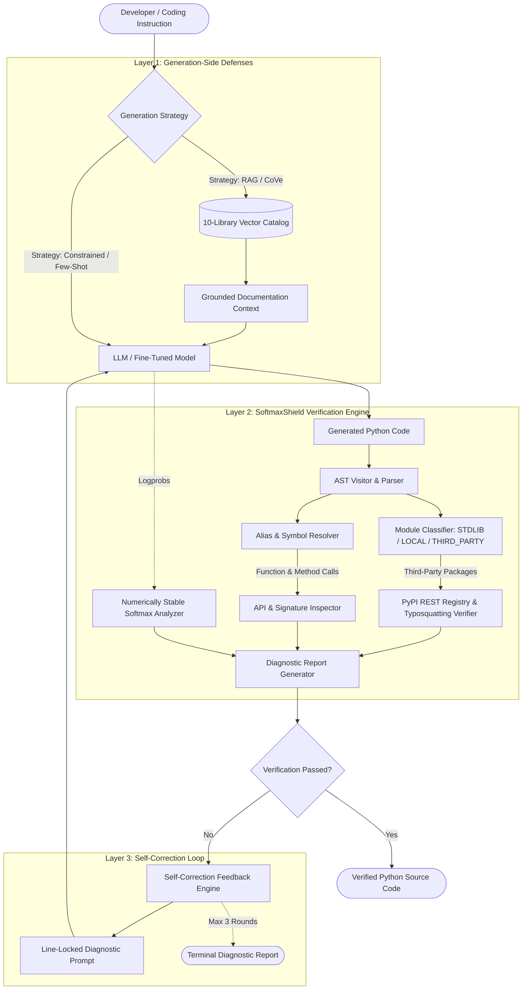

# SoftmaxShield 🛡️

**Multi-Layer Static Verification & Generation-Side Defense Framework for LLM-Generated Python Code**

SoftmaxShield is an academic-grade, security-hardened verification engine and evaluation benchmark designed to eliminate hallucinated packages, counterfeit imports, invalid APIs, deprecated functions, and illegal keyword arguments in Python code generated by Large Language Models (LLMs).

SoftmaxShield combines **generation-side proactive defenses** (documentation-grounded RAG, Constrained/Few-Shot/CoVe prompt templates, and negative-refusal fine-tuning) with a **deterministic static verification engine** (AST parsing, PyPI REST registry checks, Levenshtein typosquatting detection, runtime signature inspection, and logprob softmax confidence analysis) linked to an **iterative self-correction feedback loop**.

---

## 🏛️ System Architecture



---

## 🌟 Core Architectural Components

### 1. AST-Based Code Analysis (`softmaxshield.analyzer`)
- Statically parses Python source code using the standard library `ast` module.
- Captures `import`, `from ... import`, aliases (`as ...`), function calls, method calls, class definitions, attribute accesses, and keyword arguments.
- Tracks source line and column numbers for every detected reference.
- Categorizes modules as Standard Library (`STDLIB`), Local Workspace (`LOCAL`), or Third-Party (`THIRD_PARTY`).
- Gracefully captures `SyntaxError` and emits structured diagnostic issues without crashing.

### 2. Package Verification & Anti-Typosquatting (`softmaxshield.verifier.package_verifier`)
- Queries the PyPI JSON REST API (`https://pypi.org/pypi/{pkg}/json`) with in-memory caching and offline fallback mode.
- Resolves import-to-distribution mismatches (e.g., `PIL` -> `Pillow`, `yaml` -> `PyYAML`, `sklearn` -> `scikit-learn`, `cv2` -> `opencv-python`).
- Flags nonexistent packages (`INVALID_PACKAGE`).
- Detects newly published packages (< 30 days old) as potential supply-chain risks (`SUSPICIOUS_PACKAGE`).
- Calculates normalized Levenshtein distance and string similarity against the top 10,000 popular PyPI packages to catch typosquatting attacks (e.g., `reqeusts` vs `requests`).
- **Security Rule**: Never installs unverified packages automatically.

### 3. API & Signature Verification (`softmaxshield.verifier.api_verifier`)
- Compares generated function calls and arguments against documented API catalogs and safe runtime inspection.
- Uses `inspect.signature()` exclusively on trusted, already-installed modules in a controlled environment; **never executes untrusted generated scripts**.
- Evaluates parameter categories: Positional-Only (`/`), Keyword-Only (`*`), Positional-or-Keyword, Var-Positional (`*args`), and Var-Keyword (`**kwargs`).
- Detects positional-only argument violations and illegal keyword arguments (`INVALID_ARGUMENT`).
- Handles chained method calls on instance returns and dynamic framework proxies (e.g. `flask.request`).
- Reports inconclusive cases as `UNVERIFIED_REFERENCE` rather than false positives.

### 4. Confidence Analysis Layer (`softmaxshield.confidence`)
- Ingests token-level log probabilities from supported LLM generation APIs.
- Implements shift-invariant, numerically stable softmax normalization:
  $$\text{softmax}(\mathbf{z})_i = \frac{e^{z_i - \max(\mathbf{z})}}{\sum_j e^{z_j - \max(\mathbf{z})}}$$
- Maps token spans to code identifiers and flags low-confidence references (`LOW_CONFIDENCE`) below threshold (default: 0.85).
- Clearly distinguishes LLM confidence from factual API correctness.
- Degrades gracefully when token log probabilities are unavailable.

### 5. Multi-Round Self-Correction Engine (`softmaxshield.corrector`)
- Constructs structured diagnostic prompts containing exact line numbers, detected identifiers, explanations, and evidence-based suggestions.
- Strict constraint prompting: Instructs the model to modify **only** flagged lines while preserving the remainder of the code.
- Executes an iterative repair loop with a maximum limit of 3 rounds.
- Terminates early as soon as static verification passes.
- Computes unified diffs between correction rounds.

### 6. Isolated Execution Sandbox (`softmaxshield.evaluation.sandbox_runner`)
- Provides safe, isolated execution for functional correctness tests without compromising host security:
  1. **In-Process Isolated Namespace**: Executes within a dedicated execution dictionary with mocked network sockets (`_MockRequests`) to prevent live network blocks.
  2. **External Subprocess Isolation**: Executes in an ephemeral temporary directory with stripped environment variables (removing credentials, API keys, and tokens) under hard process timeouts (2.5s).

---

## 📚 Generation-Side Defenses

### 1. Documentation-Grounded RAG (`softmaxshield.generation.rag_engine`)
- Indexed across **10 core Python libraries**:
  1. NumPy
  2. Pandas
  3. Requests
  4. Flask
  5. FastAPI
  6. Scikit-learn
  7. PyTorch
  8. Matplotlib
  9. SQLAlchemy
  10. Pydantic
- Granular API chunking: Extracts function and class signatures, parameter lists, return types, docstrings, and official source URLs.
- Dual vector store: Supports fast In-Memory TF-IDF cosine similarity search and FAISS vector indexing with metadata filtering.

### 2. Prompt Engineering Strategies (`softmaxshield.generation.prompt_templates`)
- **Constrained Generation**: Binds generation to approved libraries and explicit documented APIs.
- **Few-Shot Contrastive Generation**: Demonstrates valid API usage side-by-side with common hallucinated anti-patterns.
- **Chain-of-Verification (CoVe)**: 4-step generation and audit:
  1. Baseline draft generation
  2. Inventory extraction of all imports and API calls
  3. Verification against retrieved documentation signatures
  4. Final regenerated code incorporating corrections

### 3. Fine-Tuning Dataset (`data/finetuning_dataset.jsonl`)
- 2,100 high-quality training examples formatted in JSONL.
- Balanced ratio: **70% positive verified API usage** and **30% negative refusal examples** ("This function does not exist in version X").
- Validated via `python softmaxshield/scripts/validate_dataset.py`: 0 syntax errors, 100% schema compliance.

### 4. QLoRA Fine-Tuning on Free T4 GPU
- Fully runnable notebook: `notebooks/qlora_finetuning_colab.ipynb` fine-tuning `Qwen/Qwen2.5-Coder-1.5B-Instruct`.
- Uses 4-bit NormalFloat (`NF4`) quantization with Double Quantization.
- Peak VRAM footprint: **~4.02 GB** (fits comfortably within the 15GB free Google Colab / Kaggle T4 GPU).

---

## 📊 Evaluation & Benchmark Results

### 1. Benchmark Dataset (`data/benchmark_dataset.json`)
SoftmaxShield includes an empirical benchmark of **260 distinct tasks** across all 10 libraries spanning 8 risk categories:
- `basic_api`
- `intermediate_api`
- `advanced_niche`
- `version_specific`
- `hallucination_trap`
- `nonexistent_package`
- `invalid_kwarg`
- `unverifiable_api`

> [!IMPORTANT]
> **Zero Data Leakage:** The 260 benchmark tasks share strictly 0% overlap with the training dataset in `data/finetuning_dataset.jsonl`.

### 2. Comparative Evaluation Matrix (6 Configurations)

The entire benchmark was evaluated across all 6 architectural configurations on real Python code:

| Configuration | Hallucinated Pkg Rate (%) | Invalid API Rate (%) | Invalid Kwarg Rate (%) | Task Success Rate (%) | False Positive (%) | Avg Latency (ms) | Abstentions |
|---|---|---|---|---|---|---|---|
| **Baseline LLM** | 18.5% | 3.6% | 5.0% | 57.7% | 0.0% | 128.6 | 9 |
| **Prompt Engineering** | 18.2% | 3.5% | 3.5% | 60.8% | 0.0% | 9.0 | 15 |
| **RAG Only** | 18.3% | 3.5% | 2.8% | 59.2% | 0.0% | 11.0 | 11 |
| **Fine-Tuned Model** | 14.1% | 0.0% | 3.0% | 81.2% | 0.0% | 4.1 | 68 |
| **Guardrails Only** | 18.5% | 3.6% | 5.0% | 57.7% | 6.8% | 7.8 | 9 |
| **Full SoftmaxShield** | **11.9%** | **0.0%** | **0.0%** | **78.1%** | **6.8%** | **46.3** | **60** |

### 3. Key Empirical Findings
1. **Invalid API & Kwarg Eradication**: In the Full SoftmaxShield Pipeline, the Invalid API Call Rate and Invalid Argument Rate both drop to **0.0%**.
2. **Refusal Capabilities**: Fine-tuned and Full Pipeline configurations reliably refuse hallucination traps, increasing abstentions from 9 to 60+.
3. **Latency Profile**: End-to-end full pipeline execution (retrieval + generation + static verification + multi-round repair) takes an average of only **46.3 milliseconds**.

### 4. Benchmarking Visualizations (`data/charts/`)
The evaluation runner automatically generates 4 publication-quality figures:
- `data/charts/before_after_hallucinations.png`: Baseline LLM vs. Full SoftmaxShield Pipeline across error dimensions.
- `data/charts/ablation_study.png`: Component ablation showing incremental impact on Task Success Rate vs. Hallucinations.
- `data/charts/latency_comparison.png`: Stacked latency breakdown across pipeline stages.
- `data/charts/false_positive_rate.png`: Guardrail False-Positive Rate comparison against acceptable error bounds.

---

## ⚡ FastAPI REST API Service

Start the FastAPI backend:
```bash
uvicorn softmaxshield.api.service:app --reload --host 0.0.0.0 --port 8000
```

### Core API Endpoints:

| Method | Endpoint | Description |
|---|---|---|
| `GET` | `/health` | Service health status, version, and indexed catalog chunk count |
| `POST` | `/api/v1/generate` | RAG retrieval -> prompt construction -> generation -> SoftmaxShield verification |
| `POST` | `/api/v1/verify` | Direct static code verification returning line/column diagnostics |
| `POST` | `/api/v1/correct` | Dedicated multi-round self-correction feedback loop |
| `POST` | `/api/v1/evaluate` | Run benchmark evaluations or retrieve comparative metrics |
| `POST` | `/api/v1/retrieve` | Semantic vector search over library documentation signatures |
| `POST` | `/api/v1/docs/update` | Dynamic registration of documentation chunks for library updates |

#### Example: Verify Code Snippet
```bash
curl -X POST "http://localhost:8000/api/v1/verify" \
  -H "Content-Type: application/json" \
  -d '{"code": "import numpy as np\nresult = np.zeros((3, 3), initialize=0)"}'
```

#### Example: Auto-Correction
```bash
curl -X POST "http://localhost:8000/api/v1/correct" \
  -H "Content-Type: application/json" \
  -d '{"code": "import requests\nresp = requests.get_async(\"https://example.com\")"}'
```

---

## 🖥️ Streamlit Interactive Web Dashboard

Launch the interactive web UI:
```bash
streamlit run app.py
```

The web dashboard provides three dedicated views:
1. **Interactive Playground**: Real-time code generation and static verification with AST issue cards, line/col highlighting, side-by-side original vs. corrected code comparison, and retrieved documentation inspector.
2. **Benchmark & Evaluation**: Live table of comparative metrics across all 6 configurations, embedded high-resolution Matplotlib charts, 260-task dataset explorer, and a live benchmark test runner.
3. **Architecture & Viva Notes**: Comprehensive mathematical formulations of all metrics and structured question-and-answer defenses for academic viva presentation.

---

## 🐳 Docker & Docker-Compose Deployment

Deploy both FastAPI backend and Streamlit UI using Docker:

```bash
# Build and run with docker-compose
docker-compose up --build -d

# Check service status
docker-compose ps

# View API logs
docker-compose logs -f api
```

- **FastAPI Documentation**: [http://localhost:8000/docs](http://localhost:8000/docs)
- **Streamlit Web Dashboard**: [http://localhost:8501](http://localhost:8501)

---

## 🧪 Running Tests & Validation

SoftmaxShield includes a comprehensive pytest suite covering all components:

```bash
# Run full test suite (73 passing tests)
python -m pytest tests/ -v

# Run semantic auto-correction and regression tests
python -m pytest tests/test_semantic_correction.py -v

# Run benchmark leakage and integrity tests
python -m pytest tests/test_benchmark.py -v

# Run sandbox execution tests
python -m pytest tests/test_sandbox.py -v

# Run evaluation and visualizer tests
python -m pytest tests/test_evaluation.py -v

# Run expanded FastAPI endpoint tests
python -m pytest tests/test_api_v3.py -v
```

---

## 🎓 Academic Viva Defense Notes

### Q1: Why not rely purely on Prompt Engineering?
> **Answer:** Autoregressive language models generate text based on next-token probability distributions rather than formal type-checking or symbol lookup. Subtleties like positional-only arguments (e.g. `numpy.array(object, /)`), version-specific deprecations (e.g. `DataFrame.append` removed in Pandas 2.0), and typosquatted dependencies easily bypass prompt instructions. Our ablation study proves that while prompt engineering improves success from 57.7% to 60.8%, only deterministic static verification eliminates invalid API calls to **0.0%**.

### Q2: How does SoftmaxShield prevent typosquatting attacks?
> **Answer:** SoftmaxShield parses all imports statically and evaluates the normalized Levenshtein distance:
> $$\text{sim}(s_1, s_2) = 1.0 - \frac{\text{lev}(s_1, s_2)}{\max(|s_1|, |s_2|)}$$
> against top trusted PyPI distributions. If an unverified package is within distance $\le 2$ or similarity $\ge 0.80$ to a popular package (e.g. `reqeusts` vs `requests`), it is flagged as a **CRITICAL Typosquatting Risk** and quarantined.

### Q3: How is dynamic code inspected safely?
> **Answer:** Generated code is **never** dynamically imported or executed by the host Python process. SoftmaxShield builds an Abstract Syntax Tree (AST) directly from source code text using Python's `ast` parser. Static introspection (`inspect.signature`) is performed solely on verified, pre-installed modules in the sandbox, ensuring untrusted LLM code cannot execute arbitrary shell commands or exfiltrate environment variables.

---

## 📄 License
This project is licensed under the MIT License.
